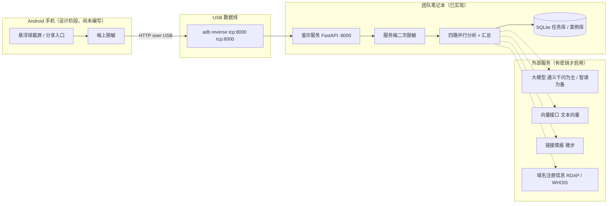
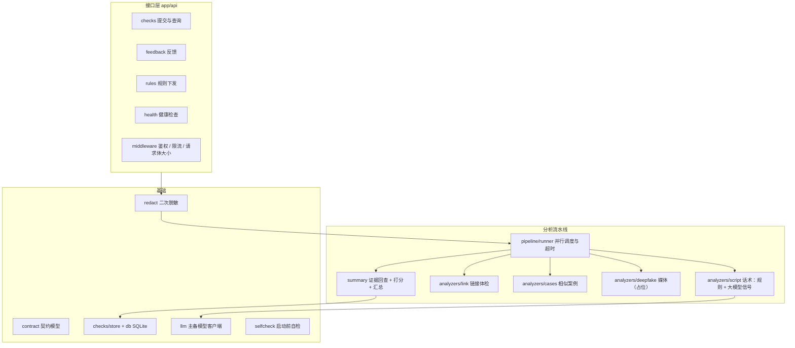
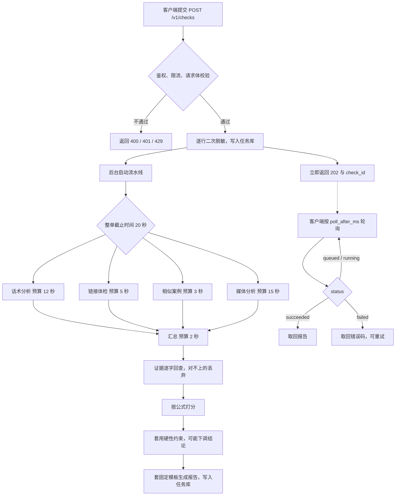
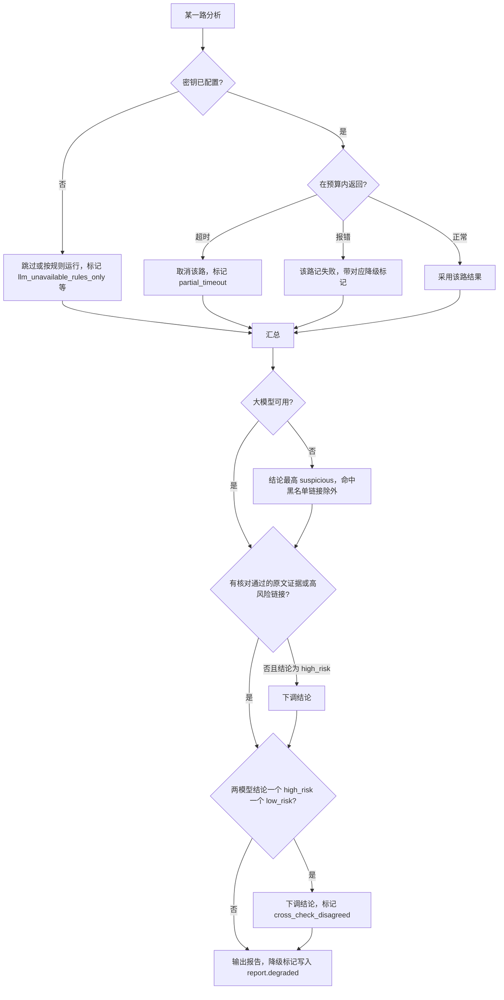

# AI 智能反诈系统：项目报告（初稿）

> 状态：**初稿**。本稿只覆盖方案 B「一键鉴诈」已经提交到仓库的部分，供文档组在此基础上修改，不代表可直接提交的定稿。
>
> 依据的代码版本：提交 **a89c899**（`docs(server): feedback and rules endpoints in Android handoff and progress`，2026-11-11）。除特别注明外，正文中的实现描述都以该提交为准；媒体与合成语音检测在该提交时正在开发、尚未提交（之后的提交 bbabeb5 已加入相关代码，本稿未覆盖，见待补清单），Android 客户端尚未开始编写，这两部分只按设计文档描述。
>
> 占位标记：缺材料的地方写成「【待补：……】」，缺实测数据的地方写成「【待实测：……】」，全文搜索这两个标记即可列出全部缺口。

## 目录

1. [作品概述](#1-作品概述)
2. [系统组成及功能说明](#2-系统组成及功能说明)
3. [性能参数](#3-性能参数)
4. [总结与展望](#4-总结与展望)
5. [参考文献 / 参考项目](#5-参考文献--参考项目)
6. [附录：本稿依据的文件](#6-附录本稿依据的文件)

---

## 1. 作品概述

### 1.1 作品是什么

「AI 智能反诈系统」面向普通手机用户，目标是在用户看到可疑内容的当下给出一份可核对的鉴定报告：是不是诈骗、属于哪种套路、对方哪几句话有问题、和哪些公开案例相似、下一步可以怎么做。

本期只实现方案 B「一键鉴诈」。用户在 Android 手机上点悬浮球截取当前屏幕，或者把截图、文字、链接、语音分享给 App；App 在手机上先做一次脱敏，再把内容发给跑在团队笔记本上的鉴诈服务，几秒内取回报告。手机与笔记本之间不经过公网：用 USB 数据线连接后执行 `adb reverse tcp:8000 tcp:8000`，手机访问自己的 8000 端口就到达笔记本上的服务。

方案 A（主动预警、后台常驻监控）本期不做。立项时对两类方案的取舍见立项文档，【待补：立项文档中方案选型的论证，立项文档不在本仓库内】。

### 1.2 功能

已在服务端实现并通过测试的功能：

| 功能 | 说明 | 状态 |
| --- | --- | --- |
| 提交鉴定 | `POST /v1/checks`，立即返回任务编号，客户端轮询取结果 | 已实现 |
| 取回报告 | `GET /v1/checks/{check_id}`，报告含结论、分数、场景、证据、链接、相似案例、建议 | 已实现 |
| 二次脱敏 | 服务端对手机号、身份证号、银行卡号、金额再脱敏一遍，幂等 | 已实现 |
| 话术分析 | 规则匹配 + 大模型抽取「意图信号」，结论由代码给出 | 已实现 |
| 链接体检 | 跳转展开、SSRF 防护、域名注册时间、风险分级；情报源已接微步 | 已实现 |
| 相似案例 | 案例库导入、向量检索、相似度排序 | 已实现 |
| 降级与自检 | 外部服务不可用时降级出报告；启动前逐项自检 | 已实现 |
| 反馈 | `POST /v1/checks/{check_id}/feedback`，记录用户对结论的评价 | 已实现 |
| 规则下发 | `GET /v1/rules`，带 ETag，内容没变返回 304 | 已实现 |

按设计存在、代码尚未完成的功能：

| 功能 | 说明 | 状态 |
| --- | --- | --- |
| 媒体上传 | `POST /v1/media`，图片与语音先上传再引用 | 未实现，当前返回 404 |
| 图片 OCR | 截图里的文字转成文本再走话术分析 | 设计 / 开发中，截至 a89c899 未提交 |
| 语音转写与合成语音检测 | 语音转文字，并给出合成语音的可能性 | 设计 / 开发中，截至 a89c899 未提交 |
| Android 客户端 | 悬浮球、分享入口、脱敏、轮询、报告页 | 设计阶段，尚未开始编写 |

### 1.3 应用场景

- 刷单返利：对方承诺垫付后返还更高金额，要求先转小额。
- 虚假投资理财：承诺高收益、内部渠道，催促下载指定 App 或转入指定账户。
- 冒充客服或公检法：以退款、涉嫌洗钱为由要求转账到「安全账户」或共享屏幕。
- 冒充熟人：用熟人身份借钱、要求保密、阻止核实。

规则集当前覆盖的场景分布见 3.1 节。这些场景的选取依据见立项文档，【待补：立项文档中的用户调研与场景论证】。

### 1.4 特点

1. **结论由代码给出，不由大模型给出。** 大模型只负责从对话里抽取结构化信号（哪一句表达了什么意图），分数、结论、场景归类都由确定性代码计算。同样的输入和同样的信号，结论可复现，也便于解释每一分从哪来。
2. **证据必须能在原文里逐字找到。** 报告里引用的每一句话都要是用户提交文本的逐字子串，对不上的引用会被丢弃或修正行号。用户看到的「有问题的原话」可以自己回原文核对。
3. **硬性约束兜底。** 例如：没有一条核对通过的原文证据、也没有高风险链接时，不能给「高风险」；大模型全部不可用时，结论最高到「可疑」（命中黑名单链接除外）；只有合成语音分数、没有其他证据时，不能单独给「高风险」。
4. **断网也能出报告。** 大模型、情报源、域名查询都不可用时，系统退回到规则匹配，并在报告里标明降级原因，而不是失败或一直等待。
5. **隐私数据两次脱敏。** 手机上脱敏一次，服务端入库、进大模型、写日志之前再脱敏一次；链接体检只读响应头、不读正文，避免把页面内容带回来。
6. **部署在团队自己的笔记本上。** 不依赖云服务器，演示和路演用一根数据线即可；代价是并发能力和可用性受单台笔记本限制，见 4.2 节。

### 1.5 性能指标

工程指标（超时预算、测试规模、无密钥时的实测用时）见第 3 节，全部注明了测量条件。

效果指标目前没有：

- 准确率、召回率、精确率、误报率：【待实测：需要冻结的标注数据集和大模型密钥，测量方法见 3.4 节】。
- 合成语音检测准确率：【待实测：检测模型尚未提交，且没有标注的语音测试集】。
- 真实大模型下的端到端时延：【待实测：仓库内没有任何大模型密钥，真实模型从未运行过】。

仓库里有一份 12 条合成样例（`server/eval/data/synthetic.jsonl`），只用于验证评测脚本能跑通。按评测脚本自己的说明，在它上面跑出的任何数字都不是系统效果，本稿不引用。

### 1.6 创新点

以下是相对常见做法的设计差异，供文档组取舍，不写成已发表成果：

1. **信号与结论分离。** 把大模型限制在「抽取信号」这一步，结论、分数和场景由代码根据显式公式计算，并设有硬性约束。这样模型换代或不可用时，结论规则不需要重写。
2. **证据可回查。** 报告中的每条证据都经过与原文的逐字比对，引用不实的证据不会进入报告。
3. **降级即功能。** 外部依赖的每一种失败都有对应的降级标记和结论上限，系统在没有网络、没有密钥时仍能给出有界限的判断，而不是只在理想环境下工作。
4. **端云契约先行。** 手机与服务之间的全部接口、字段、错误码、轮询语义先写成契约并配有示例，再分别实现，减少两端对不齐的返工。

---

## 2. 系统组成及功能说明

### 2.1 软件整体架构



虚线表示可选依赖：没有配置密钥或网络不可达时，对应的路按降级规则跳过或失败，不影响报告生成。

### 2.2 后端模块设计

服务端代码在 `AI anti lie/server/app/`，按职责分成这些模块：



各模块对应的主要文件：

| 模块 | 路径 | 职责 |
| --- | --- | --- |
| 契约模型 | `server/app/contract.py` | 请求、报告、错误码的数据结构，与契约文档一致 |
| 二次脱敏 | `server/app/redact.py` | 入库、进大模型、写日志前的再次脱敏 |
| 调度 | `server/app/pipeline/runner.py` | 四路并行、各自超时、整单截止时间、汇总 |
| 话术 | `server/app/analyzers/script/` | 规则匹配、大模型信号抽取、交叉复核 |
| 打分 | `server/app/scoring/` | 由信号计算风险概率与分数 |
| 汇总 | `server/app/summary/base.py` | 证据回查、硬性约束、报告模板 |
| 链接 | `server/app/analyzers/link/` | URL 提取、跳转展开、SSRF 防护、风险评估 |
| 案例 | `server/app/analyzers/cases/` | 案例导入、向量检索 |
| 媒体 | `server/app/analyzers/deepfake/` | 占位实现，返回「未分析」 |
| 持久化 | `server/app/db/`、`server/app/checks/` | SQLite，任务保留 7 天 |
| 自检 | `server/app/selfcheck.py` | 启动前逐项检查并给出处置建议 |

### 2.3 一次鉴定的流程



各路之间没有数据依赖，并行执行；某一路超时或失败只影响自己的输出，其余照常汇总。超时的路记为失败并带上 `partial_timeout` 降级标记。

### 2.4 降级与超时



超时预算（`server/app/config.py` 的默认值，均可通过环境变量覆盖）：

| 项目 | 默认值 |
| --- | --- |
| 整单截止时间 | 20 秒 |
| 话术分析 | 12 秒 |
| 链接体检 | 5 秒 |
| 相似案例 | 3 秒 |
| 媒体分析 | 15 秒 |
| 汇总 | 2 秒 |
| 大模型连接超时 | 3 秒 |
| 链接每一跳 | 3 秒，最多 5 跳 |
| 域名注册信息查询 | 3 秒 |
| 链接情报查询 | 3 秒 |
| 向量接口 | 2.5 秒 |

交叉复核默认开启（`cross_check = parallel`）：主模型和备用模型各抽取一次信号，两份结论一个是「高风险」、一个是「低风险」时判定为不一致，结论下调并记录标记。

### 2.5 关键代码

以下五段均从提交 a89c899 的源文件节选，行号对应该提交。省略处用注释标出。

#### 2.5.1 服务端二次脱敏

`server/app/redact.py`，脱敏顺序固定为身份证号、银行卡号、手机号、金额，且先保护 URL 和已有占位符不被误伤。数字会先从全角转成半角，使服务端与手机端的正则行为一致。

```python
# server/app/redact.py 第 110–118 行
def redact_text(text: str) -> str:
    text = _FULLWIDTH_POINT.sub(".", text.translate(_FULLWIDTH))
    text = _FULLWIDTH_ID_X.sub(lambda m: m.group(1) + ("X" if m.group(2) == "Ｘ" else "x"), text)
    # 每次改写至少消掉一个占位符以外的数字，所以一定收敛；迭代到不动点保证严格幂等。
    while True:
        new = _redact_once(text)
        if new == text:
            return text
        text = new
```

手机号替换时把国家码一起去掉，避免留下「+86<PHONE>」这种半脱敏结果（同文件第 32–37 行）：

```python
# server/app/redact.py 第 32–37 行
# 国家码 +86 / 0086 / +0086 连同号码一起替换，不留下「+86<PHONE>」；不带 + 或 00 的「86」不算国家码
_PHONE_RE = re.compile(
    rf"{_PROTECT}"
    rf"|(?:\+(?:00)?|(?<![0-9])00)86[ \-－\u3000]?1[3-9][0-9]{{9}}(?![0-9])"
    rf"|(?<![0-9])1[3-9][0-9]{{9}}(?![0-9])"
)
```

身份证号和银行卡号不是只看位数：18 位数字还要校验位通过才替换为 `<ID>`，16–19 位数字还要通过 Luhn 校验才替换为 `<CARD>`（同文件第 56–58 行、第 61–70 行），避免把普通长数字误判为证件号。

#### 2.5.2 证据逐字回查

`server/app/summary/base.py`。大模型给出的每条证据，其 `quote` 必须是 `line_id` 指向那一行文本的逐字子串；行号标错的，在其他行里能找到就修正行号，找不到就丢弃。

```python
# server/app/summary/base.py 第 87–110 行
def verify_evidence(evidence: Iterable[Evidence], inp: AnalysisInput) -> list[Evidence]:
    """只保留 `quote` 是某一行逐字子串的证据；行号标错的修正，找不到的丢弃。按原文顺序、去重。"""
    order = {line.line_id: i for i, line in enumerate(inp.lines)}
    search_order = list(inp.iter_lines(COUNTERPART_SPEAKERS)) + [
        l for l in inp.lines if l.speaker not in COUNTERPART_SPEAKERS
    ]
    kept: list[Evidence] = []
    seen: set[tuple[str, str, Intent]] = set()
    for ev in evidence:
        quote = ev.quote.strip(_QUOTE_TRIM)
        if not quote:
            continue
        line = inp.line(ev.line_id)
        if line is None or quote not in line.text:
            line = next((l for l in search_order if quote in l.text), None)
        if line is None:
            continue
        key = (line.line_id, quote, ev.intent)
        if key in seen:
            continue
        seen.add(key)
        kept.append(ev.model_copy(update={"line_id": line.line_id, "quote": quote}))
    kept.sort(key=lambda e: order.get(e.line_id, len(order)))
    return kept
```

规则命中转成的证据不经过这一步，因为规则的 `quote` 本身就是从原文匹配出来的子串（同文件 `rule_evidence`，第 113 行起）。

#### 2.5.3 打分与硬性约束

分数由六个分量相加后过 sigmoid 得到，不由模型直接给出。`server/app/scoring/__init__.py` 第 207–215 行：

```python
# server/app/scoring/__init__.py 第 207–215 行
def score(signals: Signals, w: Weights) -> Score:
    return Score(
        bias=w.bias,
        intents=intent_component(signals.evidence, w),
        rules=rule_component(signals.rules, w, llm_available=signals.llm_available),
        links=link_component(signals.links, w),
        cases=case_component(signals.cases, w),
        deepfake=deepfake_component(signals.media, w),
    )
```

风险概率 p = sigmoid(bias + 意图 + 规则 + 链接 + 案例 + 深伪)，`risk_score = round(100·p)`。阈值：p ≥ 0.60 为 high_risk，p ≤ 0.05 为 low_risk，介于其间为 suspicious；suspicious 的分数钳在 6–59，high_risk 不低于 60，low_risk 不高于 5。各分量的权重定义在同文件的 `Weights` 中，【待补：权重取值的确定依据，立项文档 5.3 / 5.4 不在本仓库内】。

硬性约束在打分之后执行，只能下调结论、不能上调。`server/app/summary/base.py` 第 243–268 行：

```python
# server/app/summary/base.py 第 243–268 行
def apply_constraints(
    d: Decision,
    *,
    has_evidence: bool,
    links: list[LinkResult],
    llm_available: bool,
    other_verdict: Verdict | None,
    w: Weights,
) -> Decision:
    has_high_link = any(link.risk == LinkRisk.HIGH for link in links)
    # 1. high_risk 至少要有一条通过回查的原文证据，或一条 high 风险链接
    if d.verdict == Verdict.HIGH_RISK and not (has_evidence or has_high_link):
        _cap(d, "no_evidence", w)
    # 2. 深伪分数单独不足以给出 high_risk：去掉深伪分量后够不上 high_risk 就不给
    if d.verdict == Verdict.HIGH_RISK and verdict_for(d.score.p_without_deepfake, w) != Verdict.HIGH_RISK:
        _cap(d, "deepfake_alone", w)
    # 3. 交叉复核：一方 high_risk、另一方 low_risk 才算不一致
    if other_verdict is not None and {d.verdict, other_verdict} == {Verdict.HIGH_RISK, Verdict.LOW_RISK}:
        _cap(d, "cross_check", w)
        d.flags.append(DegradedFlag.CROSS_CHECK_DISAGREED)
    # 4. 大模型全部不可用：最高 suspicious（命中黑名单的链接除外）
    if not llm_available:
        if d.verdict == Verdict.HIGH_RISK and not any(is_blacklisted(link) for link in links):
            _cap(d, "llm_unavailable", w)
        d.flags.append(DegradedFlag.LLM_UNAVAILABLE_RULES_ONLY)
    return d
```

另外两条由汇总层保证：可分析文本不足 10 个字、且没有链接和媒体时，结论为 inconclusive；报告文案经过检查，不允许出现「安全」「可以放心」一类保证性表述（同文件 `_clean`，第 289–293 行）。

#### 2.5.4 四路并行与超时

`server/app/pipeline/runner.py`。每路分析器拿到的超时是「本路预算」和「整单剩余时间减去汇总预算」中的较小值，到点未返回就取消：

```python
# server/app/pipeline/runner.py 第 184–201 行（节选，缩进已左移）
async def run_one(analyzer: Analyzer) -> None:
    timeout = min(analyzer.timeout_s(settings), max(0.0, deadline - summary_budget - loop.time()))
    ctx = AnalyzerContext(
        services=self.services,
        check_id=inp.check_id,
        trace_id=inp.trace_id,
        deadline=loop.time() + timeout,
    )
    t0 = loop.time()
    task = asyncio.create_task(analyzer.run(inp, ctx), name=f"analyzer:{analyzer.name.value}")
    done, _ = await asyncio.wait({task}, timeout=timeout)
    elapsed = _ms(loop.time() - t0)
    error: str | None = None
    output: AnalyzerOutput
    if not done:
        task.cancel()
        task.add_done_callback(_retrieve)
        error = "timeout"
        # ... 记为失败，带 partial_timeout 降级标记
```

四路通过 `asyncio.gather` 同时启动（同文件第 250 行），全部结束后才进入汇总。某路抛出异常或返回不合规的结果时，只把该路记为失败，不中断其他路。

#### 2.5.5 链接体检的 SSRF 防护

链接体检要主动去访问用户提交的网址以跟踪跳转，因此每一跳都先校验目标再连接，避免被用来探测内网。`server/app/analyzers/link/net.py` 第 42–51 行，只允许公网单播地址，并排除了映射地址、兼容地址和隧道地址里嵌套内网地址的情况：

```python
# server/app/analyzers/link/net.py 第 42–51 行
def is_public_ip(ip: IPAddress) -> bool:
    """只有公网单播地址返回 True。云厂商元数据（169.254.169.254、100.100.100.200、fd00:ec2::254）都不是公网地址。"""
    if isinstance(ip, ipaddress.IPv6Address):
        if ip.ipv4_mapped is not None:
            return is_public_ip(ip.ipv4_mapped)
        if int(ip) >> 32 == 0:  # ::a.b.c.d（已废弃的 IPv4 兼容地址）和 ::
            return False
        if any(ip in net for net in _NAT64 + _TUNNELS):  # 里面嵌的 IPv4 可能是内网
            return False
    return ip.is_global and not ip.is_multicast
```

展开过程逐跳进行：先解析并校验 IP，再把连接钉在解析出的那个 IP 上发请求（不走系统代理，防止代理绕过钉 IP），只读响应头不读正文，最多 5 跳（同文件第 164–175 行、第 189–206 行）：

```python
# server/app/analyzers/link/net.py 第 189–206 行（节选）
        trace.requests += 1
        try:
            response = await asyncio.wait_for(
                transport.handle_async_request(pinned_request(current, ip, timeout)), timeout=timeout
            )
        except asyncio.TimeoutError:
            trace.stopped = "timeout"
            return trace
        # ...
        try:
            location = response.headers.get("location") if response.is_redirect else None
        finally:
            await response.aclose()  # 只读响应头，不读正文
```

单段主机名（如 `localhost`）和 `local`、`internal`、`lan` 等后缀的主机名在解析前就直接拒绝（同文件第 39 行、第 54–57 行）。

### 2.6 已实现的功能说明

**提交与查询。** 提交接口做 Bearer 令牌校验、按设备的令牌桶限流（默认每分钟 20 次、突发 10 次）、请求体大小限制（默认 1 MB）和字段校验，通过后返回 202 与 `check_id`。查询接口返回各分析器状态；完成后 `status` 为 `succeeded`，报告在 `report` 字段。任务在 SQLite 中保留 7 天，启动时清理过期任务。

**话术分析。** 先用规则集做正则匹配，规则集版本 2026.11.2，共 69 条，覆盖刷单返利、投资理财、冒充客服、冒充熟人等场景，每条规则带场景、意图和权重。大模型部分使用 OpenAI 兼容接口，主模型通义千问（qwen3.7-plus）、备用智谱（glm-5.3-flash），提示词要求模型只输出结构化信号。模型输出不直接进入报告，先经 2.5.2 节的回查。

**链接体检。** 从文本中提取网址并展开跳转链，检查是否命中本地黑名单、是否为可下载的安装包、域名注册时间是否过新，并结合情报源给出风险等级。情报源目前接入微步（ThreatBook），奇安信与腾讯的情报源尚未实现。风险等级的映射集中在 `server/app/analyzers/link/features.py` 的 `assess_risk`。

**相似案例。** 案例以 JSONL 导入，向量为 1024 维，存于 SQLite。检索时取对话文本的向量，按相似度返回最接近的公开案例。没有向量密钥或案例库为空时，这一路跳过。

**反馈与规则下发。** 用户可以对一条报告标注判断是否正确，服务端只记录不回改结论。规则下发接口支持 `If-None-Match`，规则内容未变化时返回 304，便于手机端缓存。

**启动前自检。** `uv run python -m app.selfcheck` 逐项检查配置文件、令牌、数据库可写性、规则版本、主备模型连通性、链接数据文件、域名查询、案例库与向量接口、ffmpeg，并给出每一项的处置建议。大模型或向量接口不可用时服务仍可启动，报告退化为只用规则。

### 2.7 设计中、尚未实现的部分

**媒体与合成语音检测（开发中，截至 a89c899 未提交）。** 按设计，图片走 OCR 后并入文本分析，语音走转写后并入文本分析，同时对语音给出合成可能性评分。评分只作为一个分量参与 2.5.3 节的公式，且受「深伪分数单独不足以给高风险」的约束。当前提交中该模块是占位实现：有媒体引用时返回 `not_analyzed` 并带 `deepfake_unavailable` 标记（`server/app/analyzers/deepfake/analyzer.py` 第 19–34 行）。计划采用的开源组件见第 5 节。

**Android 客户端（设计阶段）。** 按 `docs/frontend-agent-prompt.md` 与契约，客户端包含：悬浮球截屏与分享两个入口、端上脱敏、提交与轮询、报告展示、反馈、规则缓存。界面尚无任何实现。

【待补：App 主界面截图】

【待补：悬浮球截屏入口截图】

【待补：报告页截图（含证据、链接、相似案例三块）】

【待补：降级状态的报告页截图】

**Windows 备机。** 运行说明按 Windows 备机写了 PowerShell 命令，但截至 a89c899 没有在 Windows 上实际运行过，【待实测：Windows 备机上的自检与完整流程】。

---

## 3. 性能参数

### 3.1 功能展示

下面用一次无密钥的真实模式运行展示降级行为。测量条件：提交 a89c899 的干净检出，Apple M1、16 GB 内存、macOS 27.0.1，未配置任何密钥，服务以 `uv run python -m app --port 8790` 启动，请求体为 `shared/contract-examples/check-request.json`。

提交后服务端日志（2026-11-12 实测）：

```text
check.created   lines=3 chars=80 urls=1 media=1 source=floating_ball
analyzer.finished analyzer=script   status=done elapsed_ms=1 note=no_llm_configured
analyzer.finished analyzer=deepfake status=done elapsed_ms=2 note=placeholder
analyzer.finished analyzer=link     status=done elapsed_ms=2 note=links=1 found=1 timed_out=False
check.succeeded verdict=suspicious risk_score=29 degraded=llm_unavailable_rules_only,deepfake_unavailable elapsed_ms=13
```

同一请求重复 6 次，服务端记录的整单用时为 17、14、6、6、5、9 毫秒。报告结论为 suspicious、分数 29，并带两个降级标记：大模型未配置所以只用规则，媒体分析为占位实现。这与 2.4 节的降级规则一致：没有大模型时结论不超过 suspicious。

需要说明：这个例子里的链接没有触发外部查询，所以链接一路也在毫秒级完成。含真实跳转展开和域名查询的用时见 3.3 节，量级不同。

【待补：真实大模型下的完整报告截图，需要密钥】

【待补：含高风险链接与相似案例的报告示例，需要情报源密钥和导入后的案例库】

### 3.2 规则集规模

`shared/rules.json`，版本 **2026.11.2**，共 **69** 条规则（提交 a89c899）：

| 场景 | 条数 |
| --- | --- |
| 刷单返利 brushing_rebate | 18 |
| 投资理财 investment | 17 |
| 其他 other | 22 |
| 冒充客服 impersonation_service | 6 |
| 冒充熟人 impersonation_acquaintance | 6 |

按意图统计：要求付款 16、高收益承诺 11、身份包装 10、诱导下载 10、小额返利 7、制造紧迫 7、阻止核实 5、要求保密 3。另有 6 条归一化短语和 5 条剔除规则。

规则是正则表达式，目前只在服务端的 Python 引擎上验证过，【待实测：同一份规则在 Android 端 Kotlin / Java 正则引擎上的匹配结果是否一致】。

### 3.3 工程性能

**测试规模。** 在上述同一台机器上，对提交 a89c899 的干净检出运行 `uv run --frozen pytest -q`：**740 项通过，7 项跳过，用时 27.14 秒**。跳过的 7 项是需要真实模型的用例（`RUN_LIVE=1` 才运行），因为没有密钥，从未执行过。测试覆盖提交与查询、契约校验、脱敏、规则匹配、话术分析、打分与汇总、链接体检与 SSRF 防护、案例导入与检索、评测脚本、降级与自检、反馈与规则下发。

**无密钥真实模式的用时。** 条件同 3.1 节。从客户端发出请求到轮询拿到 `succeeded` 的用时，6 次为 50、42、36、33、32、68 毫秒，中位数 39 毫秒；其中服务端记录的流水线用时为 5–17 毫秒，其余是进程间轮询的开销。此数字只代表「规则 + 本地链接检查 + 占位媒体」这条路径，不代表接入大模型后的用时。

**模拟模式的用时。** 模拟模式不调用任何外部服务，按固定步长返回契约里的示例报告，供客户端联调。同样机器上以 `--mock --port 8790` 启动：提交接口返回 202 的用时 8 次为 5.4、4.9、3.0、4.1、4.7、3.8、3.6、5.8 毫秒，中位数 4.4 毫秒；从提交到轮询拿到 `succeeded` 的用时 8 次中位数 3164 毫秒，范围 3070–5033 毫秒（客户端按 `poll_after_ms` 轮询，所以结果含轮询间隔造成的等待；各分析器状态里的 600 毫秒是模拟器写死的值，不是测量值）。

**启动前自检的用时。** 同一机器、无密钥、无 `.env`，运行 `uv run python -m app.selfcheck`，墙钟时间 **4.1 秒**。其中对 example.com 的一次 RDAP 查询用时 **1195 毫秒**并返回成功；主模型、备用模型、向量接口三项为「未配置」，案例库为「0 条」判失败，其余项通过。自检结果符合预期：没有密钥时这四项就不该通过。

**模拟断网下的用时。** 此为进度文档记录的既有测量（见 `docs/server-progress.md`），不是本次复测：连接直接被拒绝时，对应的路在 0.1–0.3 秒内失败返回；连接建立但对方不回应时，约 12 秒后按超时结束。真实拔网线的断网没有测过，【待实测：物理断网下从提交到出报告的用时与降级标记】。

**域名数据。** 自检报告链接体检数据为黑名单 3 条、RDAP 服务表 1201 个后缀，IANA 数据发布于 2026-10-28。黑名单只有 3 条，【待补：正式的黑名单数据及其来源】。

### 3.4 效果指标（全部待实测）

截至本稿没有任何一项效果指标。原因：没有大模型密钥，真实模型从未运行；没有冻结的标注测试集；媒体检测模型尚未提交。以下给出测量方法，供后续补测后填入。

| 指标 | 现状 | 测量方法 |
| --- | --- | --- |
| 召回率、误报率、精确率 | 【待实测】 | 准备标注数据集（每条含 `label` 为 fraud 或 normal），在 `server/` 下运行 `uv run python -m eval.run_eval <数据集路径>`，读取输出的混淆矩阵。阈值按契约取 0.60 |
| 固定误报率下的召回 | 【待实测】 | 同上，脚本直接输出误报率 ≤ 1%、5%、10% 时的最高召回 |
| 三支结论分布 | 【待实测】 | 同上，脚本按 0.60 / 0.05 两个阈值统计 high_risk、suspicious、low_risk 的分布 |
| 真实模型下的端到端时延 | 【待实测】 | 配置密钥后用 3.1 节的方式重复提交，取服务端 `check.succeeded` 日志的 `elapsed_ms`，报告 P50 与 P95 |
| 交叉复核的影响 | 【待实测】 | `uv run python -m eval.run_eval --cross-check both`，比较开启与关闭的召回和时延。没有密钥时两组都退化为只用规则，对比没有意义 |
| 合成语音检测准确率 | 【待实测】 | 检测实现提交后，在标注的语音集上统计；同时验证「深伪分数单独不产生 high_risk」这条约束 |
| OCR 转写正确率 | 【待实测】 | OCR 实现提交后，在截图样本上统计 |

测量时必须确认输出中没有「只用规则」的警告。评测脚本会在大模型未参与时醒目标注，那种结果只代表规则层，不能当作系统效果。

数据集方面，公开的电信诈骗文本数据集使用限制见第 5 节，其字段格式尚未核实，【待补：团队自建标注集的规模、标注规范和来源】。

---

## 4. 总结与展望

### 4.1 工作总结

截至提交 a89c899，服务端完成了：工程骨架与端云契约、模拟模式、服务端二次脱敏、69 条规则、话术分析（大模型只抽取信号）、证据逐字回查与代码打分、链接体检（含 SSRF 防护和域名注册时间查询）、相似案例检索、离线评测脚本、超时与降级、启动前自检、反馈接口和规则下发接口。全量测试 740 项通过、7 项因缺少密钥跳过。

尚未完成的有：媒体上传、图片 OCR、语音转写与合成语音检测（开发中，截至 a89c899 未提交），以及全部 Android 客户端（设计阶段）。没有任何大模型或情报源密钥，因此真实模型、真实断网、真机连接都还没有验证。

### 4.2 改进之处

1. **密钥与真实环境验证缺失。** 这是当前最大的缺口。没有真实模型的运行数据，效果指标全部空白，超时预算是否合理也只在模拟条件下验证过。
2. **案例库为空，黑名单只有 3 条。** 相似案例和链接黑名单的实际效果取决于数据，目前都是空的或象征性的。
3. **单机部署的限制。** 服务跑在一台笔记本上，默认最多 4 个鉴定并行，数据库是 SQLite。这对演示够用，但不能作为长期在线服务；若要扩展，需要单独的部署方案。
4. **情报源不完整。** 设计了三个情报源，只接入了微步。
5. **规则的跨引擎一致性。** 规则是正则，手机端要用另一个正则引擎执行同一份规则，尚未实际对照。
6. **两端脱敏规则的细微差异。** 服务端比契约字面多处理了全角数字、国家码合并等情况，手机端实现时需要同步，否则两端脱敏结果可能不同。

### 4.3 心得体会

这一节是团队成员自己的内容，本稿不代写。下面是可以展开的素材，文档组采访对应同学后填入第一人称内容。

【待补：团队成员的心得体会，建议每人一段，覆盖自己负责的部分】

可展开的技术取舍（供采访时参考，不是正文）：

- **为什么让大模型只抽取信号、由代码出结论。** 模型直接给「是诈骗」无法复现、无法解释、也无法在模型不可用时降级；把模型限制在抽取，结论规则就可以单独测试、单独调整。代价是提示词工程更细，模型输出还要做逐字回查。
- **为什么服务跑在笔记本上而不是租服务器。** 演示不依赖公网和预算，一根数据线就能跑；用户的对话内容不出自己的设备与团队的机器。代价是并发低、换机要重配、路演时网络环境不可控，所以做了降级和自检。
- **为什么证据必须逐字回查。** 大模型会复述时改写用词，改写后的「原话」用户对不上原文，反而降低可信度。回查会丢掉一些其实正确但措辞不同的证据，这是有意接受的损失。
- **为什么高风险设了硬性前提。** 误报一条「高风险」会让用户错失正常交易或误判正常沟通，所以没有原文证据支撑时宁可不给高风险。

### 4.4 展望

- 完成媒体链路：图片 OCR、语音转写、合成语音检测，并让检测分数接入现有的打分与约束框架。
- 完成 Android 客户端并通过 `adb reverse` 与服务端联调。
- 配置密钥后跑通真实模型，用冻结的标注集测出 3.4 节列出的指标。
- 充实案例库与黑名单，接入其余情报源。
- 在 Windows 备机和真机上完成一次完整路演彩排，包括物理断网的降级演示。

---

## 5. 参考文献 / 参考项目

以下每一条都核对过出处。开源项目标注了仓库许可证；模型权重、数据集另有单独条款的，单独注明。

### 5.1 论文

1. Jung J, Heo H S, Tak H, Shim H, Chung J S, Lee B J, Yu H J, Evans N. AASIST: Audio Anti-Spoofing using Integrated Spectro-Temporal Graph Attention Networks. arXiv:2110.01200, 2021. https://arxiv.org/abs/2110.01200 （作者在 arXiv 页面注明 "submitted to ICASSP2022"，本稿未另行核实会议录用结果。）
2. Gao Z, et al. FunASR: A Fundamental End-to-End Speech Recognition Toolkit. Proc. INTERSPEECH, 2023. 引用信息取自仓库 README 的 BibTeX。https://github.com/modelscope/FunASR
3. An K, Chen Q, Deng C, et al. FunAudioLLM: Voice Understanding and Generation Foundation Models for Natural Interaction Between Humans and LLMs. arXiv:2407.04051, 2024. https://arxiv.org/abs/2407.04051 （SenseVoice 所在的技术报告，作者按姓氏字母序排列，仓库 README 标注为 work in progress。）
4. Yan Z, Zhang Y, Yuan X, Lyu S, Wu B. DeepfakeBench: A Comprehensive Benchmark of Deepfake Detection. Advances in Neural Information Processing Systems (NeurIPS), 2023: 4534–4565. https://arxiv.org/abs/2307.01426
5. Li J, Zhang C, Jiang L. Innovative Telecom Fraud Detection: A New Dataset and an Advanced Model with RoBERTa and Dual Loss Functions. Applied Sciences, 2024, 14: 11628. https://doi.org/10.3390/app142411628 （Telecom_Fraud_Texts_5 数据集作者要求引用的论文，经 Crossref 核对。）

### 5.2 开源项目与数据集

| 项目 | 用途（在本项目中） | 许可证 | 地址 |
| --- | --- | --- | --- |
| FastAPI | 服务端 Web 框架，已使用 | MIT | https://github.com/fastapi/fastapi |
| SQLAlchemy | 数据库访问，已使用 | MIT | https://github.com/sqlalchemy/sqlalchemy |
| Pydantic | 契约数据结构，已使用 | MIT | https://github.com/pydantic/pydantic |
| pytest | 测试框架，已使用 | MIT | https://github.com/pytest-dev/pytest |
| AASIST（clovaai/aasist） | 合成语音检测的计划组件，**尚未接入** | 代码 MIT | https://github.com/clovaai/aasist |
| FunASR（modelscope/FunASR） | 语音工具包，计划用于转写，**尚未接入** | 代码 MIT；预训练模型权重另有独立许可，以各模型卡为准 | https://github.com/modelscope/FunASR |
| SenseVoice（QwenAudio/SenseVoice） | 语音转写的计划模型，**尚未接入** | 仓库代码 MIT；SenseVoiceSmall 权重遵循 FunASR Model Open Source License Agreement，使用前需核对模型卡 | https://github.com/QwenAudio/SenseVoice |
| RapidOCR（RapidAI/RapidOCR） | 图片 OCR 的计划组件，**尚未接入** | Apache-2.0 | https://github.com/RapidAI/RapidOCR |
| DeepfakeBench（SCLBD/DeepfakeBench） | 深伪检测的参考基准与计划数据来源，**尚未使用** | CC BY-NC 4.0，仅限非商业用途 | https://github.com/SCLBD/DeepfakeBench |
| have_I_been_scammed（linkenthegreat/have_I_been_scammed） | 方案 B 思路来源，仅参考其提示词分工，未使用其代码或数据 | Apache-2.0 | https://github.com/linkenthegreat/have_I_been_scammed |
| Telecom_Fraud_Texts_5（ChangMianRen/Telecom_Fraud_Texts_5） | 评测数据的候选来源，**未下载** | 仓库标注 GPL-3.0；数据集本身仅限高校与科研机构科研使用，禁止任何商业用途，使用时须注明来源 | https://github.com/ChangMianRen/Telecom_Fraud_Texts_5 |

两点需要团队确认：

- DeepfakeBench 与 Telecom_Fraud_Texts_5 都有非商业限制。若竞赛规则允许科研性质的使用，引用时仍须保留许可说明；若有商业展示环节，这两项不能用，【待补：确认竞赛对数据集许可的要求】。
- SenseVoice 与 FunASR 的模型权重许可独立于代码许可，真正接入前要逐个核对模型卡，不能只看仓库的 MIT 标识。

---

## 6. 附录：本稿依据的文件

刷新本稿时，先看这些文件相对 a89c899 有没有变化：

| 内容 | 文件 |
| --- | --- |
| 接口、字段、错误码、轮询语义 | `AI anti lie/docs/api-contract.md` |
| 后端设计目标与取舍 | `AI anti lie/docs/backend-agent-prompt.md` |
| Android 端设计目标 | `AI anti lie/docs/frontend-agent-prompt.md` |
| 分步实现记录与既有测量 | `AI anti lie/docs/server-progress.md` |
| 架构、模块、运行方式 | `AI anti lie/server/ARCHITECTURE.md`、`AI anti lie/server/README.md`、`AI anti lie/docs/android-handoff.md` |
| 规则集 | `AI anti lie/shared/rules.json` |
| 评测方法与合成样例的使用限制 | `AI anti lie/server/eval/README.md` |
| 超时与限额默认值 | `AI anti lie/server/app/config.py` |

本稿第 3 节中标注「2026-11-12 实测」的数字是在该提交的干净检出上重新测量的，测量条件写在各小节内。
